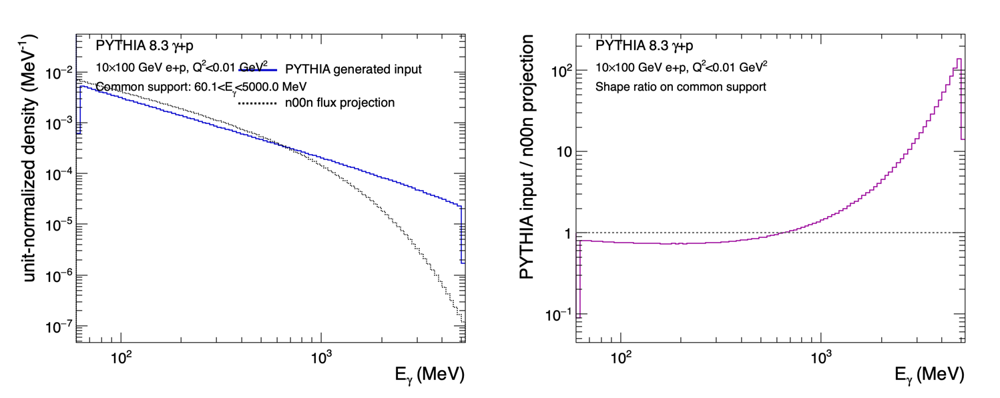
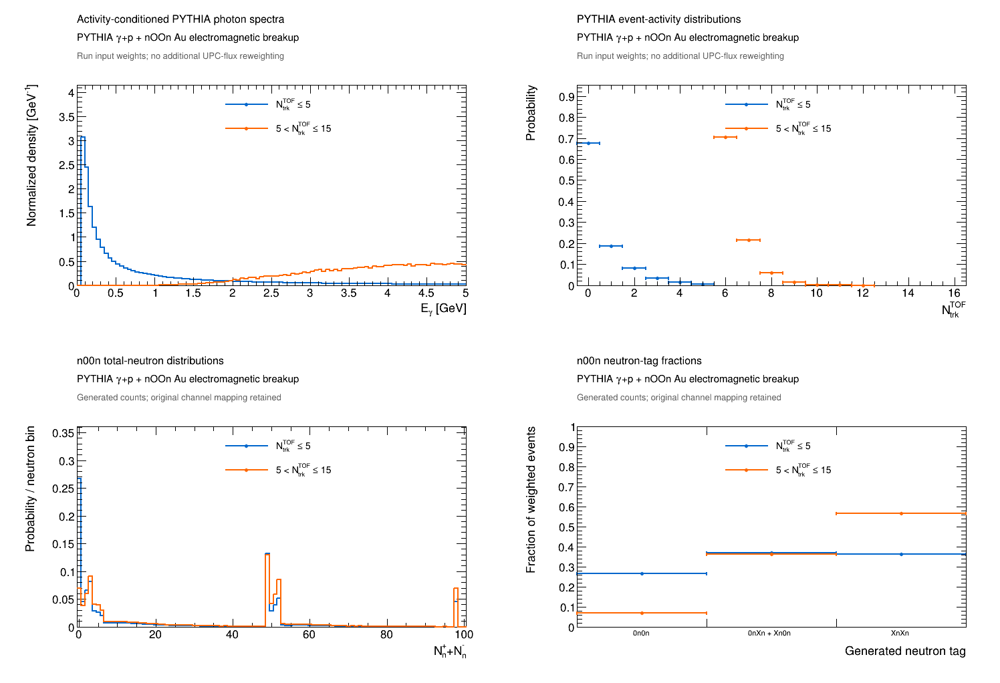

# n00n flux -> PYTHIA + STAR-like response -> n00n neutrons

This directory packages the complete model workflow used to connect the n00n
photon flux to a PYTHIA 8.3 gamma+p final state, apply a simplified STAR-like
charged-track response, and pass activity-selected events to the original
n00n electromagnetic-breakup afterburner.

```text
n00n flux Phi(E_gamma,b)
          |
          v
common-support E_gamma weights
          |
          v
PYTHIA 8.3 gamma+p events (10 x 100 GeV e+p, Q2 < 0.01 GeV2)
          |
          v
charged truth -> kinematic acceptance -> 95% TPC -> 65% TOF
          |
          v
N_TOF <= 5 and 5 < N_TOF <= 15 event classes
          |
          v
n00n Au electromagnetic breakup -> neutron distributions and tags
```

The n00n flux is used exactly once, through the event weight stored in the
PYTHIA analysis output. The neutron afterburner consumes `totalWeight` and does
not apply the flux or detector response a second time.

## Repository contents

- `n00n_flux_from_Ashik_da/noon_flux.root`: n00n two-dimensional photon flux
  `h2fluxNoon_wPnohad(E_gamma,b)`; the photon-energy axis is in MeV.
- `reweighting_factors_ep10x100_test17-18_updated_analysis_macro.txt`:
  representative normalized target/source shape ratio on the common
  PYTHIA-n00n support.
- `macros/11_13_2026/simrun15mb_ep.C`: STAR/PYTHIA 8.3 generator
  configuration retained with the November analysis snapshot.
- `macros/11_13_2026/analysis.cxx`: photon reconstruction, n00n flux
  weighting, detector
  response, multiplicity classes, correlations, and the `noonEvents` interface
  tree.
- `macros/11_13_2026/reweight_egamma.C`: regenerates the common-support
  weight table and performs a closure test.
- `macros/11_13_2026/plot_pythia_post_generation_essentials*.C`: PYTHIA and
  detector QA.
- `PYTHIA_root_files/egamma_less5gev_ep10x100_test17-18_updated_analysis_macro2.root`:
  standard generated output path. The 592 MiB reference file is locally
  generated/Git-ignored; its checksum is documented in that directory.
- `noon_original/NeutronGenerator.*` and `noon_original/Data/`: original
  breakup generator and its nuclear inputs.
- `noon_original/run_pythia_noon.C`: event-by-event PYTHIA-to-n00n interface.
- `noon_original/plot_pythia_noon_qa.C`: activity-conditioned neutron and
  closure QA.
- `scripts/run_chain.sh`: end-to-end driver starting from a compiled PYTHIA
  analysis executable and generator file list.
- `scripts/validate_chain.C`: checks metadata, required branches, completion,
  and photon-energy closure.
- `examples/figures/`: representative November 2026 QA output. Production ROOT
  files are intentionally excluded because they are hundreds of MB.

## Prerequisites

Two environments are used:

1. **STAR software environment** for event generation and compilation/running
   of `macros/11_13_2026/analysis.cxx`. It must provide StarPythia8, ROOT, the generated
   `genevents` reader, and the existing analysis build files.
2. **ROOT 6 with a C++ compiler** for the n00n afterburner and all plotting
   macros. The tested local version was ROOT 6.26/10.

The package does not contain the large generator event files or the local STAR
build products. Put absolute paths to the generator ROOT files, one per line,
in a file list.

## Quick start

Clone the repository and enter this directory:

```bash
git clone https://github.com/eicsouvik/pythia-low-egamma-cutoff.git
cd pythia-low-egamma-cutoff/model_chain
./scripts/check_environment.sh
```

In the STAR environment, compile `macros/11_13_2026/analysis.cxx` with the same
`genevents.cxx`, `genevents.h`, and `GNUmakefile` used for the generator tree.
Then run the complete weighted-analysis, QA, and neutron-afterburner chain:

```bash
./scripts/run_chain.sh \
  /absolute/path/to/analysis \
  /absolute/path/to/pythia_files.list \
  production_001
```

The analysis command executed by the driver is equivalent to:

```bash
analysis py8 pythia_files.list \
  PYTHIA_root_files/egamma_less5gev_ep10x100_test17-18_updated_analysis_macro2.root \
  reweighting_factors_ep10x100_test17-18_updated_analysis_macro.txt
```

The final ROOT files are:

```text
PYTHIA_root_files/egamma_less5gev_ep10x100_test17-18_updated_analysis_macro2.root
outputs/production_001/n00n_afterburner/pythia_noon.root
```

Set `MAX_NOON_ENTRIES` for a short afterburner test:

```bash
MAX_NOON_ENTRIES=1000 ./scripts/run_chain.sh \
  /absolute/path/to/analysis /absolute/path/to/pythia_files.list smoke
```

The PYTHIA analysis still reads every input event in this mode; only the n00n
afterburner is shortened.

## Regenerating the photon-flux weights

The included table was made by normalizing the source and target spectra on
their common support, then taking the bin-by-bin target/source ratio. To
regenerate it from an unweighted PYTHIA analysis file containing `egamma`:

```bash
root -l -b -q \
  'macros/11_13_2026/reweight_egamma.C("/path/to/unweighted.root","n00n_flux_from_Ashik_da/noon_flux.root","new_weights.txt",1.0)'
```

The macro reports the fraction of the n00n flux below the first usable PYTHIA
bin and produces a closure comparison. The PYTHIA `Photon:Wmin = 5 GeV`
configuration implies a low-energy edge near 60 MeV for a 100 GeV proton beam;
the flux below that edge cannot be recovered by reweighting.

## Physics and detector definitions

- Photon selection: `0 < E_gamma < 5 GeV`, `0 <= Q2 < 0.01 GeV2`.
- Charged-track acceptance: final-state charged particles with
  `|eta| < 1`, `0.2 < pT < 2.0 GeV/c`.
- TPC response: independent 95% Bernoulli efficiency after acceptance.
- TOF response: independent 65% Bernoulli match conditional on TPC
  reconstruction; TOF defines event activity but TPC tracks define the
  analysis tracks.
- Activity classes: `N_TOF <= 5`, `5 < N_TOF <= 15`, and a retained closure
  class above 15. The neutron workflow uses the first two classes.
- Weight convention: `totalWeight = generatorWeight * noonFluxWeight`.

## Validation and interpretation cautions

`scripts/run_chain.sh` finishes by checking that the PYTHIA output records
applied n00n weights and detector metadata, the afterburner is complete, the
required interface branches exist, and the photon-energy spectra entering and
leaving n00n agree bin by bin.

The following are known model limitations, not plotting defects:

- The generator has no support below its minimum gamma+p mass threshold, so a
  reported fraction of the n00n flux remains uncovered.
- Passing the reconstructed PYTHIA laboratory-frame `E_gamma` directly to the
  symmetric Au+Au n00n interface assumes the energy-frame mapping is valid.
- The original n00n channel implementation contains aggregate Xn channels.
  Treat structures near generated counts 49 and 98 as channel-mapping artifacts
  until aggregate channels are sampled as physical exclusive multiplicities.
- n00n models accompanying electromagnetic breakup. It does not add the
  struck-nucleus remnant or intranuclear cascade from the primary gamma+A
  interaction.
- The 95%/65% detector response is a controlled approximation, not a full STAR
  detector simulation or a data-driven `(pT,eta)` efficiency map.

See [NOTICE.md](NOTICE.md) for upstream-code provenance.

## Representative output

PYTHIA weighting and detector response:



n00n neutron-afterburner overview:



